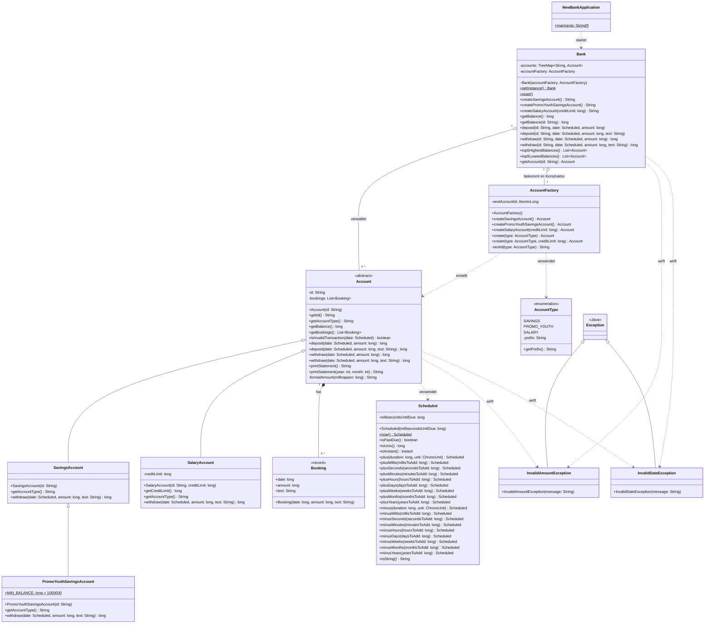

# Klassendiagramm

Stand: Sprint 5 (Singleton Pattern). Das Diagramm zeigt alle Java-Klassen aus
`new-bank/src/main/java/ch/bbw` mit Attributen, Methoden, Vererbung und Beziehungen.

Legende: `+` public, `-` private, `~` paketintern, `*` abstrakt, `$` statisch.
Beträge sind in Millirappen (`long`), Datumswerte in Millisekunden (Unix-Zeit).

## Erklärungen

- **Vererbung:** `Account` ist abstrakt und gibt mit `getAccountType()` eine
  abstrakte Methode vor. `SavingsAccount` und `SalaryAccount` erben direkt von
  `Account`, `PromoYouthSavingsAccount` erbt von `SavingsAccount`. Jede
  Unterklasse überschreibt `withdraw(date, amount, text)` mit ihrer eigenen
  Regel (kein negativer Saldo, Mindestsaldo bzw. Kreditlimite).
- **Factory Pattern:** `Bank` erstellt nie selbst ein Konto, sondern ruft die
  `AccountFactory` auf. Nur die Factory kennt die konkreten Kontoklassen, die
  `Bank` arbeitet nur mit der abstrakten Klasse `Account`.
- **Singleton Pattern:** Es gibt genau eine `Bank`, man holt sie mit
  `Bank.getInstance()` (Holder-Idiom, lazy und thread-sicher). Der Konstruktor
  ist paketintern und bekommt die `AccountFactory` hineingegeben, damit Tests
  eine eigene Bank bauen können. `reset()` leert die Bank und existiert nur für
  Tests (Workaround). Die Begründung steht im JavaDoc von `Bank`.
- **AccountType:** Das Enum hält Kontotyp und Präfix der Kontonummer
  (`S`, `Y`, `P`) an einem Ort zusammen.
- **Booking:** Ein Konto speichert seine Buchungen; der Saldo wird aus den
  Buchungen berechnet und nicht separat gespeichert.
